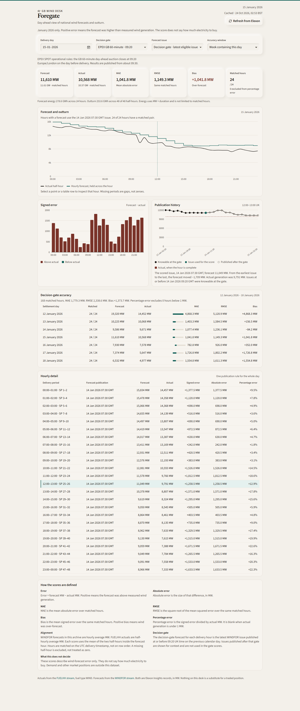
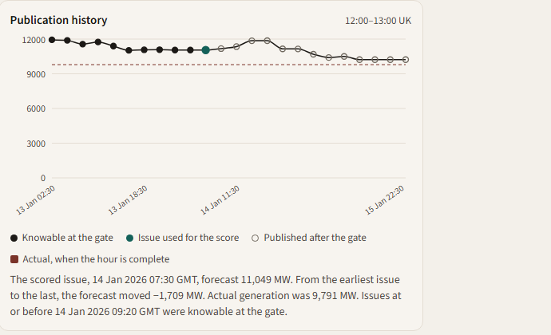

# Foregate

Foregate is a desk for GB national wind. It compares Elexon measured generation with the wind forecast that had already been published at a chosen day-ahead deadline, and it scores the difference. The score describes the forecast. It does not say how much electricity to buy.

Actuals come from the Elexon Insights FUELHH stream (`fuelType=WIND`). Forecasts come from the WINDFOR stream. There is no weather, price, demand, or solar series.





## Data

Elexon Insights base URL: `https://data.elexon.co.uk/bmrs/api/v1`. No API key.

FUELHH is requested with `settlementDateFrom`, `settlementDateTo`, and `fuelType=WIND`. `generation` is average MW. WINDFOR is requested with `publishDateTimeFrom` and `publishDateTimeTo`. Without that window the stream returns only the latest issue, so every historical score sends one.

The desk is limited to 1-31 January 2026. The API still accepts any inclusive range of up to 31 settlement days. Forecasts are fetched from four days before the first settlement date, so 1 January can use a December issue. In this month the observed publish times are 02:30, 04:30, 07:30, 09:30, 11:30, 15:30, 18:30, and 22:30 UTC. On 15 January the usual 11:30 issue was published at 12:25. Some Elexon docs list those issues an hour later. Those clocks match British Summer Time. The app stores the timestamps the API returns.

January 2026 is GMT, so UK local time and UTC match. Rows join on the UTC delivery start, not on row order. A forecast version appears in the day list only when it covers at least one hour of that day.

## Scoring

For delivery day D, the default deadline is 09:20 UK time on D-1. That is the published close of the EPEX GB 60-minute day-ahead auction, used here as a clock, not as an auction result. The score takes the latest WINDFOR `publishTime` at or before that instant. A later issue can be inspected and is not used. Two other clocks are optional because they can select a later issue: 09:50 (Nord Pool N2EX) and 15:30 (EPEX GB 30-minute close). A custom UK time is also available. The page opens on 09:20.

Pinning an issue redraws the selected day only. The accuracy section always rescores at the deadline.

Error is forecast minus actual, in MW. Positive means the forecast was above measured generation. MAE, RMSE, and bias use the same matched hours. RMSE divides by N, not N-1. If nothing matches, the metrics are null rather than zero. Percentage error is omitted when the absolute actual is below 1 MW.

An hourly actual is the mean of the two FUELHH half-hours in that clock hour. If either half-hour is missing, the hour is unmatched. Missing values are not treated as zero. Daily MAE uses that day's matched hours. A week or a month is scored from every matched hour in the window, not by averaging the daily MAE values. With the same number of matched hours each day, MAE and bias can equal that average. RMSE does not.

The week is Monday to Sunday, clipped to January. The week of 15 January is 12-18 January (168 hours). The week of 1 January is 1-4 January. The week of 31 January is 26-31 January. January has 744 expected hours, 24 on each day. A spring clock change has 23 hours and an autumn change has 25. Those dates are outside this study month.

Forecast energy sums hourly MW for hours that have a forecast. Outturn energy sums valid half-hour MW times half an hour, including readings that cannot be scored.

## Example results

Read from the local API on 24 October 2026, deadline 09:20, `cutoff_profile=epex_60min`.

15 January 2026 uses the issue published 14 January 2026 07:30 GMT. All 24 hours match. Mean forecast 11,610 MW (11,609.6). Mean actual 10,568 MW (10,567.8). MAE 1,041.8 MW. RMSE 1,149.3 MW. Bias +1,041.8 MW, so every matched hour was an over-forecast. Forecast energy 278.6 GWh across 24 hours. Outturn energy 253.6 GWh across 48 of 48 half-hours.

12-18 January: 168 of 168 hours. MAE 1,779.3 MW. RMSE 2,338.6 MW. Bias +1,373.7 MW. Bias is below MAE, so some hours were under-forecasts.

1-31 January: 744 of 744 hours. MAE 2,142.1 MW. RMSE 2,611.7 MW. Bias +1,851.9 MW.

## Architecture

The browser calls the read-only endpoints below. Vite proxies `/api` to the API during development. Metrics are calculated only in the API. The page renders the numbers the API returns.

| Method | Path | Role |
| --- | --- | --- |
| GET | `/api/health` | Process check |
| GET | `/api/overview` | Summary for the deadline, or for a pinned issue |
| GET | `/api/forecasts` | Day chart, hourly table, publications, and one hour's history |
| GET | `/api/accuracy` | Deadline scores for a day, a week, or 1-31 January |

Shared parameters are `cutoff_profile` (`epex_60min`, `nordpool_60min`, `epex_30min`, `custom`), optional `cutoff_time` (`HH:MM`, required for `custom`), and `refresh`. Overview and accuracy take `settlement_from` and `settlement_to`. Forecasts take `settlement_date`, optional `publish_time`, and optional `start_time`. Accuracy ignores a pinned issue.

Responses are cached in the API process for 15 minutes. `refresh=true` bypasses that cache.

## Layout

```
backend/app          FastAPI app, Elexon client, alignment, metrics
backend/tests        Unit and API tests with a fake Elexon client
backend/scripts      Optional live smoke check
frontend/src         React desk
docs/screenshots     Captures from the January data
docker-compose.yml   API and the Vite dev server
render.yaml          Render service definition for the API
frontend/vercel.json Build settings for the frontend
.env.example         Environment variables, none of them secret
```

## Run locally

This checkout has a virtualenv at the repository root. It is Python 3.14.4. From `backend`:

```powershell
..\.venv\Scripts\python -m uvicorn app.main:app --host 127.0.0.1 --port 8000
```

A clean install:

```powershell
cd backend
python -m venv .venv
.\.venv\Scripts\python -m pip install -r requirements.txt
.\.venv\Scripts\python -m uvicorn app.main:app --host 127.0.0.1 --port 8000
```

```powershell
cd frontend
npm install
npm run dev
```

Open `http://localhost:5173`. The dev server proxies `/api` to `http://127.0.0.1:8000`. Node on this machine is 20.20.2. Docker and Render use Python 3.12.

## Docker

Start Docker Desktop first, then from the repository root:

```powershell
docker compose up --build
```

The API is on port 8000 and the Vite dev server is on port 5173. Inside Compose the proxy target is `http://backend:8000`.

## Environment

Copy `.env.example` to `.env` only to override a default. No key is required. `VITE_API_BASE_URL` is also listed in `frontend/.env.example`.

| Variable | Default | Meaning |
| --- | --- | --- |
| `ELEXON_BASE_URL` | Elexon Insights v1 | API origin |
| `HTTP_TIMEOUT_SECONDS` | 30 | Request timeout |
| `HTTP_MAX_RETRIES` | 3 | Retries for timeout, transport errors, 429, and 5xx |
| `CACHE_TTL_SECONDS` | 900 | In-process response cache |
| `CORS_ORIGINS` | `*` | Browser origins. The API is public and read-only |
| `NEAR_ZERO_MW` | 1 | Actuals below this are left out of percentage error |
| `LOG_LEVEL` | `INFO` | API log level |
| `FORECAST_LEAD_DAYS` | 4 | How far before delivery publications are fetched |
| `CHUNK_DAYS` | 7 | Upstream request size |
| `MAX_RANGE_DAYS` | 31 | Largest inclusive settlement range |
| `VITE_API_BASE_URL` | empty | Backend origin for a built frontend. Empty uses the Vite proxy |

## Tests

From `backend` and `frontend`:

```powershell
python -m pytest
npm test
```

`npm test` uses the Vitest forks pool, one worker, and no file parallelism. The default threads pool ran out of memory on this machine. `npx tsc --noEmit` checks the frontend types. The API tests use an in-process fake of Elexon and do not call the public API. `backend/scripts/smoke_live.py` is an optional check against a running local API.

Run on 24 October 2026:

- Backend: 40 passed, 1 warning. Starlette's test client warns that `httpx` should be replaced by `httpx2`. The tests pass with the installed `httpx`.
- Frontend: 7 passed, all in `src/lib/desk.test.ts`.
- `npx tsc --noEmit` in `frontend` exited 0 with no errors.

## Deployment

Not deployed. There is no public URL.

`render.yaml` describes a Python 3.12 web service with root directory `backend`, start command `uvicorn`, and health check `/api/health`. `frontend/vercel.json` builds the Vite app to `dist`. When those hosts are used, set `VITE_API_BASE_URL` to the API origin with no trailing slash, and set `CORS_ORIGINS` to the frontend origin.

## Limitations

- National GB wind only. No station, offshore, or onshore split.
- The deadline is a clock-time assumption. It is not a field on the forecast.
- WINDFOR history is returned only when a publish window is requested, and each issue is hourly.
- A half-hour with a missing partner is excluded from the hourly score.
- The UI does not substitute fixture data when Elexon or the API is down.
- Percentage error is blank below 1 MW.
- The cache is per API process and is lost on restart.

## Demonstration

Customer pass: open 15 January 2026. At 09:20 the scored issue is 14 January 07:30 GMT. The noon publication chart shows later issues, and they are not used for that score. Bias is positive, so the forecast was high. The score is not a buy quantity. Changing the accuracy window to the week or to all of January changes the lower section only. The cards and the day chart stay on 15 January.

Technical pass: FUELHH is half-hourly and the hourly actual is the mean of the two halves. WINDFOR is hourly and joins on the UTC start. The deadline is converted with `Europe/London`. Pinning an issue changes the day view. The accuracy section stays on the deadline. Tests use a fake Elexon client. The freshness line says whether the payload was live or cached.

## Assistance

Cursor, using Grok 4.7, assisted with the implementation, tests, and this note. The figures above were checked against the Elexon responses, not invented as sample output.
